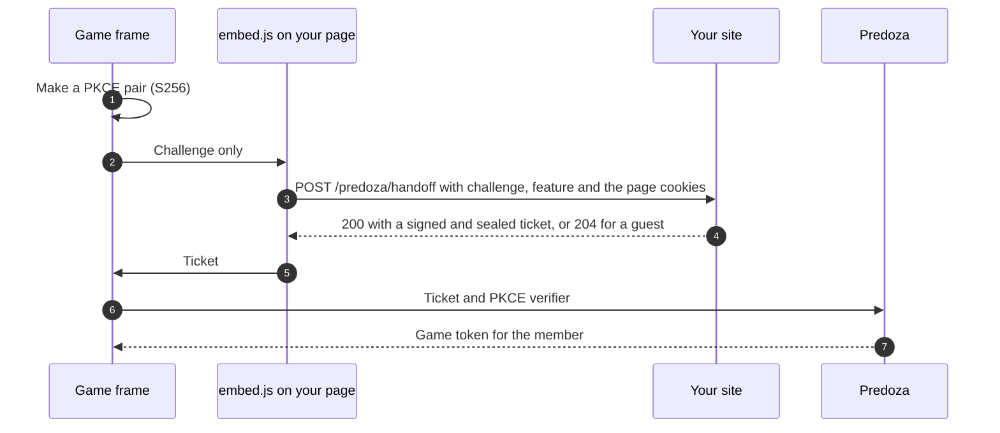

# Predoza PHP SDK

Sign your site's logged-in members in to embedded Predoza games from PHP, Symfony or Laravel.

[](https://github.com/predoza/sdk-php/actions/workflows/ci.yml)
[](https://www.php.net/supported-versions.php)
[](LICENSE)

[Predoza](https://play.predoza.com) runs sports prediction games that client sites embed on their own pages with
`embed.js`. **Host sign-in** lets a site sign its logged-in members in to the game, so they never log in twice. This
SDK implements the site's side of the protocol: the handoff route that answers the game with a sealed ticket, the
embed snippet, a setup check (the doctor) and helpers for your own tests.

This is the development monorepo. Install one of the packages below, not this repository.

## Contents

- [Packages](#packages)
- [How host sign-in works](#how-host-sign-in-works)
- [Repository layout](#repository-layout)
- [Development](#development)
- [Split repositories](#split-repositories)
- [Protocol spec and test vectors](#protocol-spec-and-test-vectors)
- [Security](#security)
- [License](#license)

## Packages

| Package | For | Repository | Packagist |
|---|---|---|---|
| [`predoza/predoza-php`](packages/predoza-php) | Plain PHP, PSR-15 apps and any other framework | [predoza/predoza-php](https://github.com/predoza/predoza-php) | [](https://packagist.org/packages/predoza/predoza-php) |
| [`predoza/predoza-symfony`](packages/predoza-symfony) | Symfony 6.4, 7.4 and 8.x | [predoza/predoza-symfony](https://github.com/predoza/predoza-symfony) | [](https://packagist.org/packages/predoza/predoza-symfony) |
| [`predoza/predoza-laravel`](packages/predoza-laravel) | Laravel 12 and 13 | [predoza/predoza-laravel](https://github.com/predoza/predoza-laravel) | [](https://packagist.org/packages/predoza/predoza-laravel) |

On Symfony or Laravel, install the framework package. Both depend on `predoza/predoza-php`. Each package has its own
README with setup steps.

## How host sign-in works

The protocol is v2. Setup: the client opens the **Host sign-in** page of the Predoza client panel, turns host
sign-in on, presses **Create site key** and puts the `PREDOZA_SITE_KEY` value into its server's environment. Then,
on every page load with a game:

1. The game frame makes a PKCE pair (S256) and passes only the challenge to `embed.js`. The verifier never leaves
   the frame.
2. `embed.js` sends `POST {data-auth-url}` (usually `/predoza/handoff`) on the page's own origin, with the page's
   cookies, the header `X-Predoza-Handoff: 1` and the JSON body `{"challenge": "…", "feature": "…"}`.
3. The site answers `200 {"ticket": "…"}` for a logged-in member or `204` for a guest. The ticket holds the member's
   claims, signed with the site's Ed25519 key and then sealed with a libsodium sealed box to Predoza's X25519 public
   key. Page scripts only ever see ciphertext.
4. `embed.js` passes the ticket to the frame, which sends it with its verifier to
   `POST https://play.predoza.com/v1/features/{feature}/auth/handoff`.
5. Predoza opens and checks the ticket and answers the frame with a game token. Predoza never calls the client's
   site.

A ticket lives 60 seconds and is accepted once. Without the verifier, a ticket copied from the page is useless.



The full protocol, including the checks Predoza runs on a ticket, is in
[`spec/host-sign-in-v2.md`](spec/host-sign-in-v2.md).

## Repository layout

```
packages/predoza-php        framework-free core (namespace Predoza\)
packages/predoza-symfony    Symfony bundle (namespace Predoza\Symfony\)
packages/predoza-laravel    Laravel package (namespace Predoza\Laravel\)
spec/                       protocol v2 spec and test vectors, copied from the Predoza repository
bin/sync-vectors            copies the spec and the vectors
```

## Development

You need PHP 8.2 or later and Composer.

```bash
composer install
composer test       # PHPUnit for all three packages
composer analyse    # PHPStan at level max
```

The root `composer.json` autoloads all three packages from `packages/*/src`, so a change to the core is tested
against both framework packages in one run. To run one package's tests, pick its suite (`predoza-php`,
`predoza-symfony` or `predoza-laravel`):

```bash
vendor/bin/phpunit --testsuite predoza-laravel
```

Each package keeps its own `composer.json`, which is the one its split repository publishes. When you add a
dependency to a package, add it there and to the root `composer.json`.

## Split repositories

On every push and tag, each directory under `packages/` is split into its own read-only repository:

| Directory | Repository |
|---|---|
| `packages/predoza-php` | [predoza/predoza-php](https://github.com/predoza/predoza-php) |
| `packages/predoza-symfony` | [predoza/predoza-symfony](https://github.com/predoza/predoza-symfony) |
| `packages/predoza-laravel` | [predoza/predoza-laravel](https://github.com/predoza/predoza-laravel) |

Packagist installs from the split repositories. Never open issues or pull requests there: open them here, in
[predoza/sdk-php](https://github.com/predoza/sdk-php).

## Protocol spec and test vectors

The Predoza repository (private) owns the protocol spec and the test vectors. The copies here are never edited by
hand. To update them, run the sync script with the path to a checkout of the Predoza repository:

```bash
bin/sync-vectors ../predoza
```

It copies `docs/host-sign-in/v2.md` to `spec/host-sign-in-v2.md` and `docs/host-sign-in/v2-vectors.json` to both
`spec/host-sign-in-v2-vectors.json` and `packages/predoza-php/tests/Fixtures/host-sign-in-v2-vectors.json`, then
prints the Predoza commit it synced from. `VectorsTest` in `predoza-php` runs the vectors; Predoza's own tests run
the same file.

v2 is fixed: a change to the spec or the vectors is protocol v3, never an edit of v2.

## Security

Do not open a public issue for a security problem. Report it privately through
[GitHub's vulnerability reporting](https://github.com/predoza/sdk-php/security/advisories/new) with a description and
the steps to reproduce it.

## License

MIT. See [LICENSE](LICENSE).
